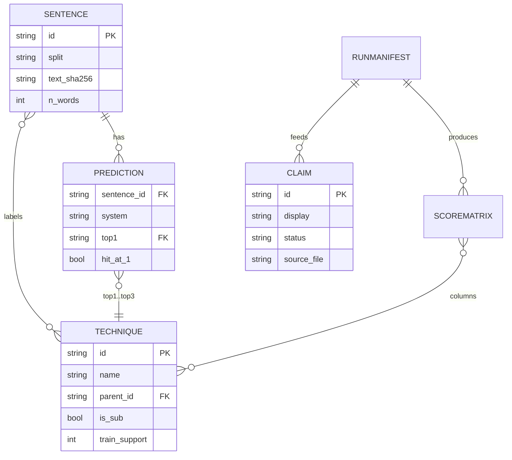

# Data dictionary

Models are defined in `src/ttpmap/schema.py` (pydantic); every shipped row is validated against them by `scripts/run_analyses.py`.
ER diagram: `figures/fig03_er_diagram.png`; Mermaid source below.

| table (file) | model | key | fields |
|---|---|---|---|
| `results/tables/sentences.parquet` | Sentence | `id` = `<split>-<4 digits>` (row position in the split) | `split`, `text_sha256` (SHA-256 of the raw text; the text is not shipped), `n_words`, `labels` (sorted unique technique ids) |
| `results/tables/techniques.parquet` | Technique | `id` (`T1234` or `T1234.001`) | `name`, `tactics` (ATT&CK v12.1 STIX), `parent_id`, `is_sub`, `train_support`, `dev_support`, `test_support` |
| `results/tables/score_matrices.parquet` | ScoreMatrix | (`system`, `seed`, `split`) | `n_sentences`, `n_labels`, `score_kind` (probability, cosine, decision_function), `source_file`, `sha256` |
| `results/tables/predictions.parquet` | Prediction | (`sentence_id`, `system`) | `top1`, `top2`, `top3`, `hit_at_1`, `rr_at_3` (test split, 9 systems) |
| notebook manifests (`manifest_*.json`) | RunManifest | `run_id` | `system`, `seed`, `config_hash`, `env`, `input_sha256`, `output_sha256`, `metrics`, `status` |
| `thesis_numbers.json` | Claim | `id` | `label`, `value`, `display`, `ci`, `definition`, `source_file`, `script`, `status`, `thesis_section`, `note` |

Conventions: technique ids are upper-case; a sub-technique is a different label from its parent; ranking ties go to the lower label index; `seed` is an integer, `avg` (mean over seeds 42-44) or `-` (deterministic).

